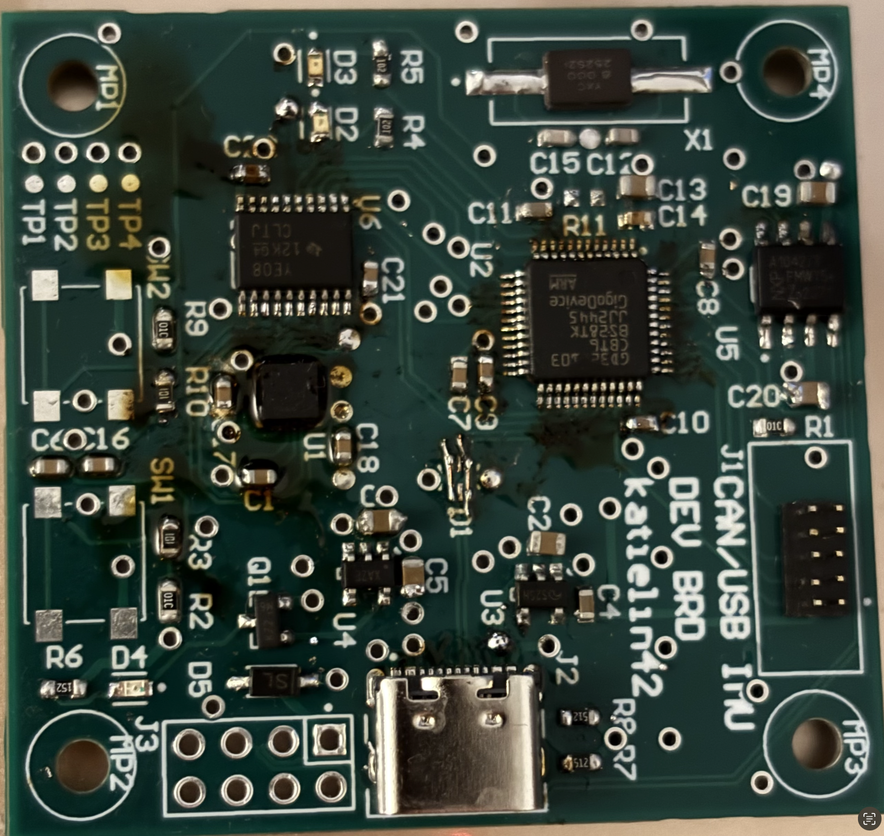

# IMU CANBUS USB Module

- A small module to communicate via CANBUS or USB with an STMF1 as the main microcontroller. USB-C port is mainly for loading firmware via a custom bootloader, while CANBUS serves as a communication protocol to other CAN devices that users will connect it to. 

# Prototype

## Introduction

- A generic IMU control module that can communicate with external modules via CANBUS or USB-C. 

## Hardware

- A 4-layer PCB, SIG -> GND -> GND -> SIG stackup. Manufactured via JLCPCB.
- This project was created with Altium Designer. 
- Note, this repo only contains the schematic, layout/stack up for this module.
- Note, the prototype has the level shifter VCCA/VCCB banks flipped, We can simply flip the component itself as the footprint is basically identical, but would be good to address in rev B. 

### Software/Firmware

- Firmware for this module can be found here [https://github.com/minh7a6]
- Download Altium Viewer to view the 3D layout for this project.
